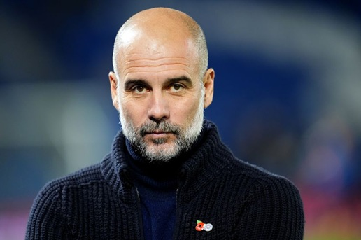

From childhood, we feel a need to have someone to look up to. For many kids, an athlete, a musician, an actor or even, at an early age, their dad, is a hero whose ways they strive to imitate. Naturally, as we mature and really learn how flawed humans are, this need is put into perspective. Still, it persists, and we see many adults showing childlike devotion to unremarkable individuals for vague reasons.

It's as if this need was encoded in our DNA. If that is the case, it would come as little surprise that, in the most successful religion humans have invented, 'a hero' is the cornerstone of the whole creed. I strongly recommend [The Weirdest People](https://www.goodreads.com/book/show/51710349), a book by Joseph Henrich that explains the tangible merits of the Christian dogma and how they inadvertently shaped the most successful societies in human history. I was educated at a religious institution where much time was spent trying to explain the Holy Trinity. This is still a mess to me, so I won't get into specifics: only the second person of the Trinity, Jesus Christ 'the Son', is relevant to this article. Notice how compelling this figure is that even atheists struggle to badmouth him. Criticism is often directed at religious institutions for taking people's money and property and imposing their morals on the lower classes while granting exceptions to the higher-ups. Jesus, however, is framed as a good-hearted hippy whose teachings were abused and took over by manipulative priests. Indeed, he meets most of the requirements I identify for a suitable hero:

1. Having *skin in the game*
2. Being anti-establishment
3. Having a remarkable life
4. Feeling authentic
5. Having a vaguely described life with many unknowns
6. Being someone you can relate to

After writing this list of requirements, I'm curious to see whether I'd be able to find a suitable role-model (the word hero sounds childish when spoken by a grown-up) for myself.

**Skin in the game** is an idea popularized by Nassim Taleb; a quote on Wikipedia shortly explains that

> To have [skin in the game](https://en.wikipedia.org/wiki/Skin_in_the_Game_(book)) is to have incurred risk (monetary or otherwise) by being involved in achieving a goal.

and why this is important for the betterment of society.

> A fund manager that gets a percentage on wins, but no penalty for losing, is incentivized to gamble with his clients' funds.
> (...)
> An evolutionary process is an additional argument for SITG. Those who err and have SITG will not survive; hence, evolutionary processes will eliminate (physically or figuratively by going bankrupt etc.) those tending to do stupid things. Without SITG, this process cannot work.

My first example, Jesus Christ, faced extreme consequences for trying to kick-start a new ethical system. He was perceived as a threat by the Romans, who believed he was actually claiming political power, and by the Jewish authorities, whose teachings they found contrary to their creed (they still do). For this, he paid the ultimate price: torture and death.

I understand that most people try to minimize risks in their careers; not everybody is cut to take financial risks in the current environment, but what I find upsetting is how this mentality translates into ethics and political opinions. Take these apparently disconnected topics: bullfighting, abortion, government spending, immigration, the military, taxes, religion, housing, the stock market, transportation, mining, energy policy or the Middle East. As soon as you have read the list you already know the topics are not that independent. We can predict almost anybody's opinions on any of those with a high degree of certainty just by knowing how people lean politically. The fact that we don't even have skin in the game even when it comes to opinions is a testament to how strong the need of group belonging is, and part of the reason why european societies are so stagnant. We accept the whole package of ideas rather than rocking the boat.

Celebrities are never contrarians, although they try to fake it with poor results, so they don't really make for role-models. In my country, a particular example is the Spanish actors' guild, whose members are supporters of the Socialist Party. First these people have joined into the same thing politics and morality and thus, anybody not sharing their politics is automatically evil. But for them, luck is on their side, as morality/politics coincide with their economic interests, until the Socialist Party departs from the expected path for practical reasons. On those occasions, no criticism is spoken and most decide to turn a blind eye. A recent example is the u-turn the party made towards their stance on the [Western Sahara conflict](https://en.wikipedia.org/wiki/Western_Sahara_conflict). This was a region administered by Spain from 1884 to 1958, and a Spanish province from 1958 until 1975, when it was conquered by Morocco after the Spanish withdrawal and the defeat of the Sahrawi independence fighters. The Saharawi cause was a pet peeve of the actors' guild for the several reasons expected from a left wing collective: anti-colonial sentiment, antifranquismo (opposition to Francisco Franco, the Spanish dictator from 1936 to 1975), opposition to an autocratic monarchy (that of Hassan II, king of Morocco) and the rights of the people to self-determination. But, for unknown reasons, in 2022, Pedro Sánchez, head of the Socialist Party and Spain's prime minister, unexpectedly backed the Moroccan government's plan for the Western Sahara and, we are still waiting for the criticism of the actor's guild to to the goverment.



It takes a huge amount of craziness for a celebrity to be a contrarian. I'm a casual MMA (Mixed Martial Arts) fan and we have many colorful personalities in the sport. Look at [Sean Strickland](https://en.wikipedia.org/wiki/Sean_Strickland). You can describe the guy with any pejorative adjective that comes to mind and likely be right. But  consider his journey from an outspoken MAGA and Donald Trump supporter to fierce critic. Strickland is a conservative, America-first, person. He supports the Amercican working class, and a non-interventionist policy in foreign affairs. Considering this, Trump was the logical choice for him in 2024, so he supported MAGA during the electoral campaign. Then in the current term, we have had to witness the atrocious destruction of the Gaza Strip by the Israelis with US support. I don't know what Strickland thinks about the Palestinians (he [has expressed some sympathy recently](https://pod.wave.co/podcast/shawn-ryan-show-1/325-sean-strickland-the-most-controversial-fighter-in-the-ufc-opens-up-like-never-before?utm_source=chatgpt.com)), but he does care about putting goverment resources into far aways wars of dubious interest for the average American. So here, the disagrements began

> I cant believe I'm saying this but I will vote for a democrat over an AIPAC ((American Israel Public Affairs Committee)) republican candidate

Then, in 2026, following the US military strikes against Iran, he accused Trump of putting foreign interests ahead of America's and contradicting the policy of non-intervention he had promised his electorate. He [has listed four areas](https://x.com/SStricklandMMA/status/2098135748432281913?ref_src=twsrc%5Etfw%7Ctwcamp%5Etweetembed%7Ctwterm%5E2098135748432281913%7Ctwgr%5Eaf463cf8e6f281195210e5f11d04cdbbb76cbeda%7Ctwcon%5Es1_c10&ref_url=https%3A%2F%2Fwww.sherdog.com%2Fnews%2Fnews%2FSean-Strickland-rips-Justin-Gaethjes-continued-Trump-support-202755) in which he believes Trump has either partly or completely failed to deliver:

- Border security and deportations: Partly fulfilled.
- Avoiding new wars: Failed.
- Cost of living: Failed.
- Government spending: Failed.

Now my point is that this kind of change of opinion, after facts don't match with actual campaign promises is rare to see, even on the more intellectual kind. And it has come from a public person that clearly has antagonized his fan base with his latests opinions.

Although an **anti-establishment** individual usually has skin in the game, these are different qualities. An entrepreneur always has it, but is not usually anti-establishment. An Occupy Wall Street activist is anti-establishment, but does not have skin in the game.



[Aaron Swartz](https://en.wikipedia.org/wiki/Aaron_Swartz) was a computer programmer and activist who supported the free sharing of information for the benefit of society. He did plenty of work baking his words until in 2010 he used his MIT credentials to make a bunch of copyrighted academic journals available to the public to download for free. This got him arrested and in court, he faced a disproportionate sentence of 35 years in prison or a deal requiring him to plead guilty. The choice basically was between a life-breaking sentence and compromising his ethics. He couldn't stand the pressure and committed suicide in 2013. Talk about a hero.

[Edward Snowden](https://en.wikipedia.org/wiki/Edward_Snowden) is a former American intelligence contractor who exposed a government scheme involving unlawful surveillance of US citizens. In 2013 he travelled to Hong Kong where he met journalists from *The Guardian* among other outlets. He was charged with espionage and fled before facing trial, and got himself stranded in Russia when the US revoked his passport. He was granted asylum there and still lives there today.

[James Watson](https://en.wikipedia.org/wiki/James_Watson) was a Nobel Prize winner in physics, one of the discoverers of the structure of DNA, and a racist. In 2007 he explicitly questioned racial equality in intelligence. In the 19th century, his stance would have been commonplace, but in the 21st, he paid a heavy price on this opinions about relationship between race, genetics and intelligence. The same year, he was forced to retire from his position as chancellor of Cold Spring Harbor Laboratory, and in 2019, after reaffirming his beliefs in a documentary, he was stripped of his remaining honorary titles. For him, this topic was not off-limits for scientists, unlike most of his peers. To me, it is up to the scientific community to refute his arguments as [Eric Turkheimer](https://en.wikipedia.org/wiki/Eric_Turkheimer) did in his 2007 article [Race and IQ](https://www.cato-unbound.org/2007/11/21/eric-turkheimer/race-iq/)

Being **authentic** is a vague personality trait. It has to do with the a person feeling at peace with himself, both with the good and the bad. Of course, an abusive alcoholic wife-beater can be very authentic, so for this quality to be valuable, it has to be paired with a **remarkable life**. The good has to outweigh the bad, but the latter still has to be visible; otherwise, it backfires and the individual is perceived as inauthentic.

Take, for example, Hollywood actors *Tom Cruise* and *Dwayne 'The Rock' Johnson*. Both became celebrities very early in life, Cruise even earlier than Johnson: he was just 21 when he starred in 'Risky Business'. Both have been methodically building their public personas for years, mastering interviews and showing the bright side that Hollywood wants them to show. However, both are perceived as inauthentic. Their controversies felt like their masks momentarily slip before they quickly put them back on. In Cruise's case, his Scientology cult and abusive relationships hint at something dark behind all the smiles. Other examples of inauthentic celebrities include *LeBron James*, and his reading habits. He's a top-3 basketball player ever, come from the bottom to stardom, from rags to riches, all on his own... but still has to be perceived as an intellectual, who is always reading the first page of whatever book he carries. Or *Lewis Hamilton*, and his support for progressive causes after making his fortune in a [shady](https://youtu.be/H7M74iEonn0?si=i4kmYd5egShFqRoy) and [heavily polluting industry](https://greenly.earth/en-gb/leaf-media/data-stories/formula-1-whats-the-real-carbon-footprint-of-racing), while dangerously driving his opponents into a wall if this is required in order to win.



Granted, if criticism is the easy part, who, then, can be perceived as authentic? To me, *Rafael Nadal* is, in a 'what you see is what you get' way. He is incredibly accomplished, but his limitations are quickly apparent, and he does not do much to hide them. Those are the personality traits are part of what made him who he is, so he has even embraced his weirdness. The already mentioned *Sean Strickland* qualifies for the reasons stated above. [Richard Feynman](https://es.wikipedia.org/wiki/Richard_Feynman) who I expect to write about in the future or [Salvador Dali](https://en.wikipedia.org/wiki/Salvador_Dal%C3%AD) qualifies too



In reality, the more media exposure you get, the less authentic you are perceived. That takes me to the next requirement, which is very hard to satisfy nowadays. A hero needs to have lived a **vaguely described life with many unknowns** in order to minimze the human misery we all share. How can someone be authentic and minimize his flaws at the same time? Well, that's the crux of the matter, and a reason why qualifying is so difficult. Mostly you can't; this happen by chance, but still one can manage his online presence to make yourself artificially scarce. But at the same time, as what really pays nowadays is to stay in the spotlight, and the longer you stay out, the greater is the chance that someone else will replace you, so it's against your interests. So it's a careful balance not entirely up to you. In his book [The Laws of Human Nature](https://www.goodreads.com/en/book/show/39330937-the-laws-of-human-nature), Robert Greene shows how [Coco Chanel](https://en.wikipedia.org/wiki/Coco_Chanel) and *Michael Jackson* managed to do exactly that in the pre-internet era. Today the landscape is very different but the philosophy is the same.



In any case, if the purpose of this blog entry is to pick a hero for myself, I have plenty of pre-2006 personalities to choose from (2006 is an arbitrary cutoff, based on when Facebook opened to the general public).

A hero needs to be **someone you can relate to**. Compare *Superman* to Jesus Christ: both are almighty, but only one is relatable. This goes for both personality and looks. You can picture yourself having a chat with Jesus; who wouldn't like drinking a beer with a hippy? Just forget that he can walk over the water and come back from the dead.Paradoxically, a comic-book hero feels more a stranger and unreachable than a god. Regarding looks, a hero needs to meet a minimum standard; nobody can relate to someone ugly. Look at how Jesus is portrayed as a handsome man in every picture. But in the end, these two, or any to be honest, qualities won't matter if the person is a member of an [out-group](https://en.wikipedia.org/wiki/In-group_and_out-group). 

For me a case in point, is *Pep Guardiola*, football coach for many top teams since 2007. He is clearly intelligent and industrious; just by listening to a press conferences, you quickly notice a stark difference between him and his peers. He was even able to learn enough German (a very difficult language) to give instructions in the sabbatical year after he left FC Barcelona and before he joined Bayern Munich. He is wickedly successful (it's very hard to find an outperforming coach), handsome and respectful. Look at how highly he praises Real Madrid CF, his bitter rival which, I guess, portraits everything he loathes most: losing (his teams have been eliminated from the Champions League by Real Madrid a total of five times) and Spanish nationalism (Real Madrid CF proudly displays the Spanish flag and its identity), given that he is a Catalan nationalist. And now I get to my point as this last statement, nevermind his obvious qualities, puts him in the out-group for me.

 

This entry is getting long enough already, but I think I have already defined the qualities a potential hero has to posses, so I'll explore more possible candidates and make my final choice in the next part.