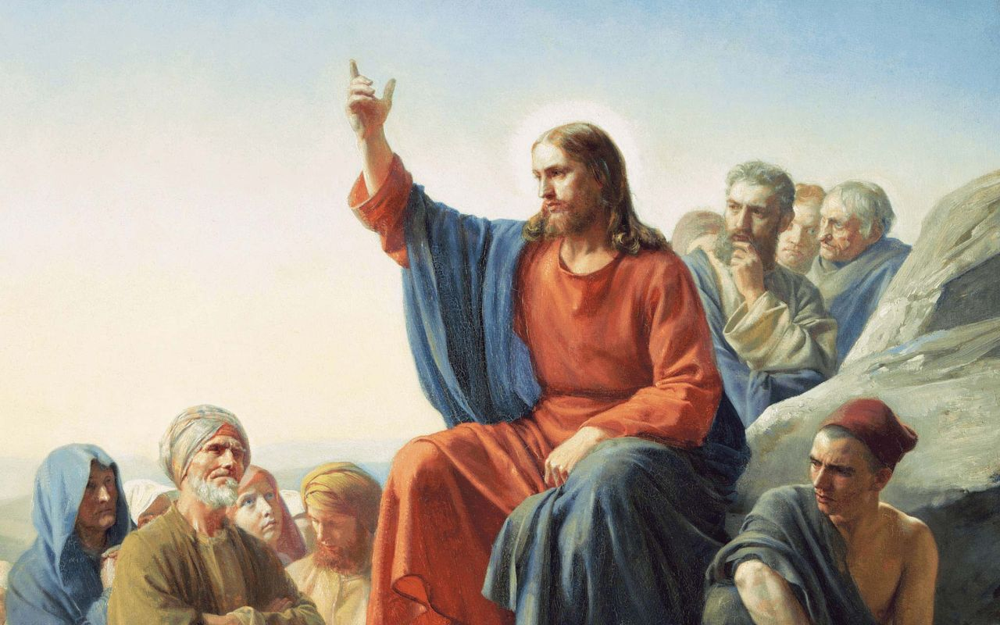
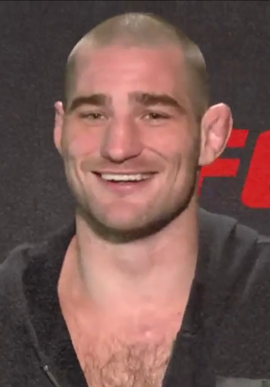
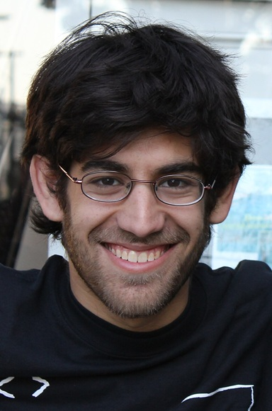
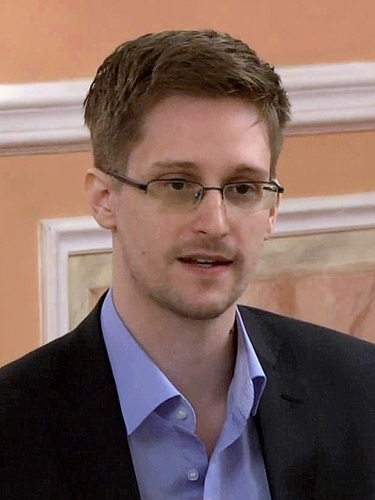
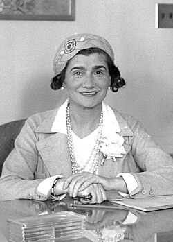

From childhood, people feel a need to have someone to look up to. For many kids, an athlete, a musician, an actor or, at an early age, even their dad is a hero whose ways they strive to imitate. Naturally, as they mature and learn how flawed people are, they put this need into perspective. Still, it persists, and we see adults showing childlike devotion to unremarkable individuals.

It's as if this need were encoded in our DNA. If that were the case, it would come as little surprise that, in the most successful religion humans have invented, 'a hero' is the cornerstone of the whole creed. I strongly recommend [The Weirdest People](https://www.goodreads.com/book/show/51710349), a book by Joseph Henrich that explains the tangible merits of Christian ideas and how they inadvertently shaped the most successful societies in human history. I was educated at a religious institution where much time was spent trying to explain the Holy Trinity. The idea is still a mess to me, so I won't get into specifics: only the second person of the Trinity, 'the Son', Jesus Christ, is relevant to this article. Notice how compelling this figure is, even atheists struggle to badmouth him. Criticism is often directed at religious institutions for taking people's money and property and imposing their morals on the lower classes while granting exceptions to the higher-ups. Jesus, however, is framed as a good-hearted hippy whose teachings were abused by manipulative priests. Indeed, he meets most of the requirements I identify for a suitable hero:

1. Having *skin in the game*
2. Being anti-establishment
3. A remarkable life
4. Has to feel authentic
5. A vaguely described life with many unknowns
6. Being someone you can relate to

I'm curious to see whether, while writing about this requirements list, I'd be able to find a suitable 'hero' for myself.

**Skin in the game** is an idea popularized by Nassim Taleb

> To have [skin in the game](https://en.wikipedia.org/wiki/Skin_in_the_Game_(book)) is to have incurred risk (monetary or otherwise) by being involved in achieving a goal.
> (...)
> A fund manager that gets a percentage on wins, but no penalty for losing, is incentivized to gamble with his clients' funds.

Back to Jesus Christ, he faced extreme consequences, while trying to kickstart a new religious/ethical system. He was perceived as a threat by the Romans as they believed he was in reality claiming political power and by the Jewish authorities whose teachings they disapproved and he paid the biggest price with his life and torture.

It's understandable most people try to minimize risks with their careers; not everybody is made to face economic risks in the current environment. But what I really find upsetting is how this mentality translates to ethics and political opinions. Take, for example, this topics: bullfighting, abortion, goverment spenditure, immigration, the military, taxes, religion, housing, the stock market, transportation, mining, energy policy or the Middle East. You can derive the opinions on any of those topics with a high degree of certainty, for almost anybody, by just asking how do they lean politically. We don't even have skin in the game on opinions. That's a testimony of how strong the feeling of belonging to the group is. We'd rather pack all ideas together rather than rocking the boat.

Celebrities are never contrarians, although they try to fake it with poor results. See the Spanish actors guild, huge supporters of the socialist party. Their morals coincide with their economic interests, but from time to time, the socialist party drifts away por practical reasons and, on those instances, they collectively decide to turn a blind eye. A damning example would be their attitude regarding the Western Sahara. A region administrated by Spain from 1884 to 1958, and a Spanish province from 1958 until 1975, when it was conquered by Morocco after the Spanish retreat and the defeat of the Saharaui independentists. This was a pet peeve of the actors guild for several reasons: the anti-colonial feeling, their antifranquismo (stance against Francisco Franco, the Spanish dictator), against an autocratic monarchy (Hassan II, king of Morocco), until in 2022 Pedro Sánchez, (head of the socialist party and Spain's prime minister), backed the Moroccan goverment plan for the Sahara and, just like that, the support from the actors guild from the Sahara cause, vanished.

It takes a huge level of craziness for a celebrity to be a contrarian. Look at [Sean Strickland](https://en.wikipedia.org/wiki/Sean_Strickland) the MMA fighter, call the guy any pejoractive adjective that comes to mind and you are likely to be right, but now consider his trip from outspoken MAGA and Donald Trump supporter, a very fierce critic. Strickland political stance is conservative, America-first, working-class supporter, and not interventionist in foreign affair. Logically Trump was the logical decision in 2024 so he supported MAGA in the 2024 campaign. Then came the atrocious destruction of the Gaza Strip by the Israelis with the support of the US and here started Strickland disagreements

> I cant believe Im saying this but I will vote for a democrat over an aipac republican candidate

Then in 2026 following the US military strikes agains Iran, he accused Trump of putting foreign interests ahead of America and contradicting the policy of non intervention he promised his electorate. He [has listed four areas](https://x.com/SStricklandMMA/status/2098135748432281913?ref_src=twsrc%5Etfw%7Ctwcamp%5Etweetembed%7Ctwterm%5E2098135748432281913%7Ctwgr%5Eaf463cf8e6f281195210e5f11d04cdbbb76cbeda%7Ctwcon%5Es1_c10&ref_url=https%3A%2F%2Fwww.sherdog.com%2Fnews%2Fnews%2FSean-Strickland-rips-Justin-Gaethjes-continued-Trump-support-202755) where he believed Trump has failed to deliver like

- Border security and deportations: Partly fulfilled.
- Avoiding new wars: Failed.
- Cost of living: Failed.
- Government spending: Failed.

To me, this evolution is logical and the comparison of campaign promises to delivered facts shows more awareness than many intellectuals, coming from a very imperfect human being.

Altough an **anti-establishment** individual has skin in the game, these are different qualities. An enterpreneur always has skin in the game, but is not usually anti-establishment. An occupy Wall Street activist is anti-establishment, but does not have skin in the game.

[Aaron Swartz](https://en.wikipedia.org/wiki/Aaron_Swartz) was a computer programmer and activist that, among other activities to support the free sharing of information, published for free download a bunch of academic journals protected by copyright. He was arrested and charged with a sentence of 35 years in prison, or to strike a deal by pleading guilty. Facing having to choose between such a disproportionate penalty and his ethics, he couldn't stand the pressure and commited suicide in 2013.

[Edward Snowden](https://en.wikipedia.org/wiki/Edward_Snowden) is a former American intelligence contractor that exposed a goverment scheme that proved unlawful surveillance conducted by the US goverment against its citizens. He was charged by espionage and run away before facing trial. He was stranded in Russia when the US voided his passport, where he got asylum and is lives nowadays.

[James Watson](https://en.wikipedia.org/wiki/James_Watson) was a physics Nobel Prize and one of the discoveres of the DNA structure, and a racist. In the 19th century his stance would have been comonplace, but in the 21st, he paid big by his opinions on the relationship between race, genetics and intelligence. In 2007 he was retired from his position as chancellor of Cold Spring Harbor Laboratory, and in 2019, after reaffirming his beliefs in a documentary, he was stripped from his remaining honorary titles. For him, seems no topic was off-limits for scientists, unlike most of his peers. The merits of his arguments are for the scientific community to rebute, if the topic is allowed to be discussed. U

Being **authentic** is a vague personality trait, having to do with being at peace with yourself both with the good and the bad. Of course, an abusive alcoholic wife-beater might look authentic, so for this quality to be valuable, it has to be paired with a **remarkable life**. The good has to outweight the bad, but the latter still has to be perceived, otherwise it backfires and the individual is perceived as inauthentic.

Take i.e. Hollywood actors *Tom Cruise* and *Dwayne 'The Rock' Johnson*. Both became celebrities very early in life, Cruise even earlier than Johnson, he was just 21 when starred in 'Risky Business' and had been methodically building their public personas for years, mastering interviews and showing the bright side Hollywood wants them to. However both are perceived as inauthentic. Their controversies felt like their mascara momentarily falling before they quickly put it back on. In the case of Cruise, his Scientology cult and abusive relationships hints at something dark behind all the smiles. Among inauthentic celebrities, *Lebron James* and his reading habits or *Lewis Hamilton* and his support of progressive causes after making his fortune in a [shady](https://youtu.be/H7M74iEonn0?si=i4kmYd5egShFqRoy) and heavily poluting industry, while dangerously driving his opponents to a wall, if that was a neccesity to win.

Granted, criticism is the easy part. Who would then, be perceived as authentic? To me, *Rafael Nadal* is, in a 'what you see is what you get' way. He is crazy accomplished but his limitating traits are recognized fast. In facts, those are personality traits are part of what made him what he is. You could even say he has embraced his weirdness. *Sean Strickland* qualifies for the reasons stated above.

In reality, the more you get exposed in the media the less authentic you feel. That takes me to the next requirement, very hard to satisfy nowadays. A hero needs to have a **vaguely described life with very unkowns** in order to 'hide' our humanly shared misery. How come someone can at the same time be authentic and hide his defects? Well, that's the crux of the matter, and a reason why qualifiyng for hero is so difficult; you can manage your online presence, and make yourself artificially scarce, but at the same time what really pays is staying in the spotlight, and the more you don't, the higher the chances for someone else to replace you. So it's a careful balance not totally up to you. In his book [The Laws of Human Nature](https://www.goodreads.com/en/book/show/39330937-the-laws-of-human-nature), Robert Greene shows how [Coco Channel](https://en.wikipedia.org/wiki/Coco_Chanel) or *Michael Jackson* managed to do exactly that in the pre-internet era. In all cases, if the purpose of this blog entry is to pick me a hero, I have plenty of pre-2006 (my arbitrary date based on when Facebook opened to the general public) personalities to choose from.

A hero needs to be **someone you can relate to**. Compare *Superman* to Jesus Christ, both are almighty but just one is relatable. This goes for both personality and looks. You can picture yourself having a chat with Jesus; who doesn't like driking a beer with a hippy, nevermind he can walk over the water and come back from the dead. Paradoxically a comic-hero feels more out of reach than a god. And, regarding looks, a hero needs to clear a minimum threshold; who can relate to someone ugly?. Look how Jesus is a handsome man on every picture available. These two qualities won't matter if the personality is a member of an  [out-group](https://en.wikipedia.org/wiki/In-group_and_out-group). A case in point, for me, is *Pep Guardiola*. He is clearly intelligent and industrious. Just by listening a press conference you notice a stark difference with his peers. Plus, how he was able to learn a good-enough German (a very difficult language) to give his instructions in a short period of time before he joined Bayern Munchen as a head coach. He is wickedly succesful, is very hard to find out a more succesfull coach, handsome and respectful. Look how he highly praise Real Madrid, his bitter rival, that has to represent all he hates most; losing (he has been eliminated in the Champions League by Real Madrid in 5 rounds) and Spanish nationalism (Real Madrid proudly carries the Spanish flag and nationality) when he is a Catalan nationalist. This makes him in the out-group for me, so despite checking most marks, he does not qualify for me.

