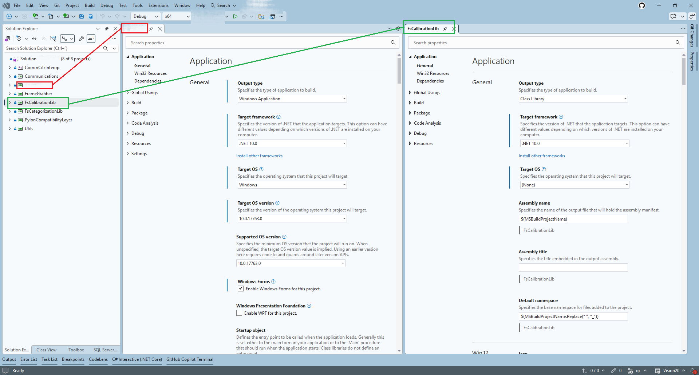
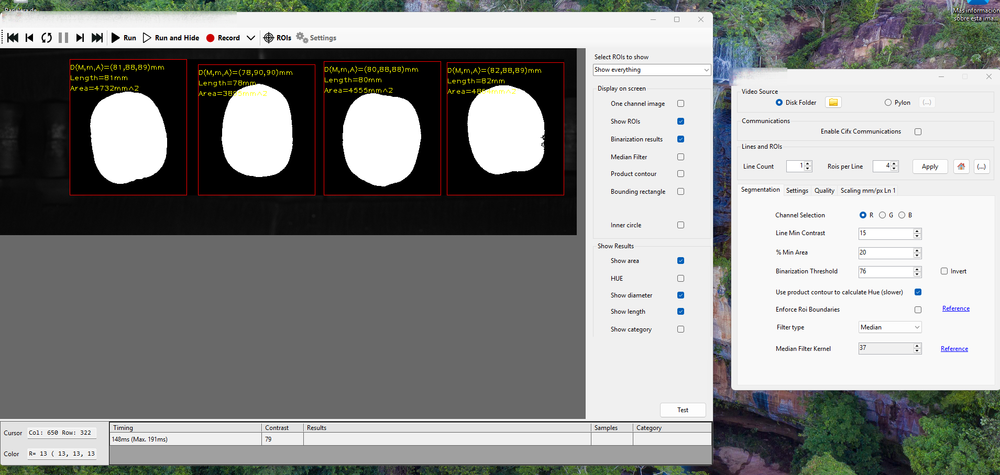
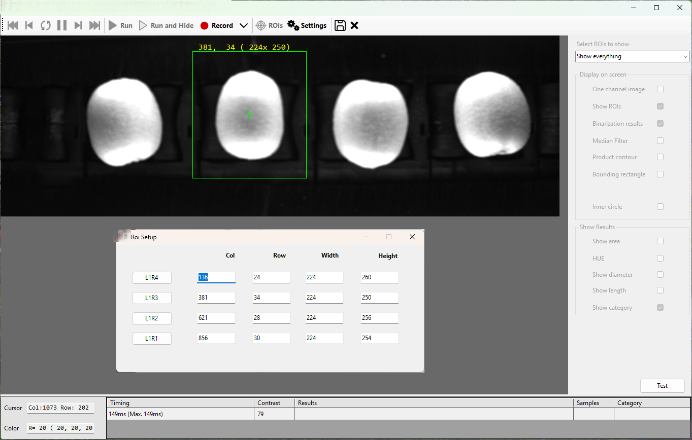
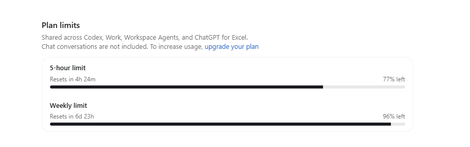
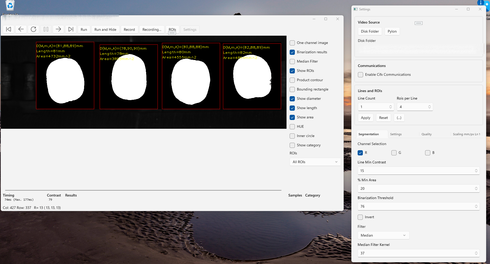
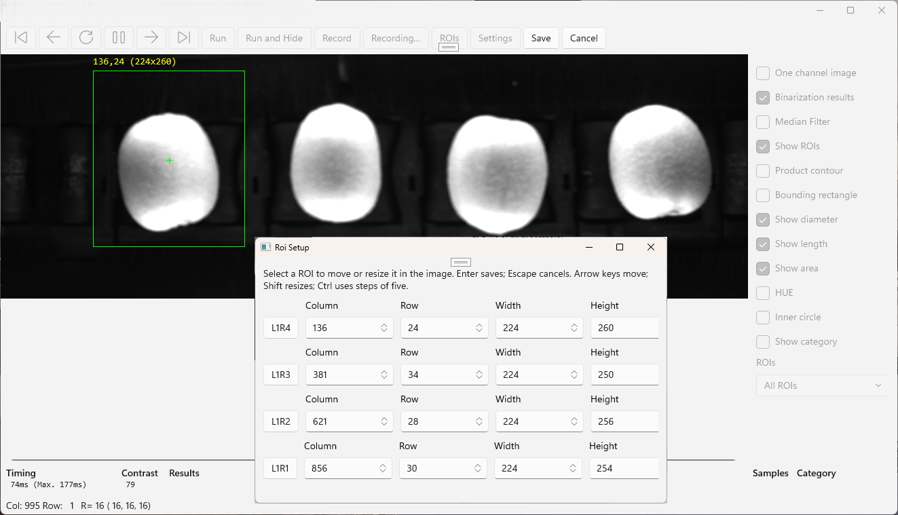

In [my previous post](), I talked about my experience writing software using LLMs. I realize, in shock, that for the past three months I haven't written any code. Today (who knows in another three months) my current workflow is as follows:

1. Divide the work in chunks, as I'd do if manually doing the code
2. Prompt to the assistant
3. Wait. If I foresee a waiting time of more than ~30 seconds, switch to another task
4. Git diff all its changes
5. Commit if it looks good. Otherwise back to step 2.

The assistants are getting so good that I'm leaning into skipping steps 1. and 4. Of course, doing that means totally relinquishing control of the source code, a jump that I've already done, ocasionally, when under heavy time pressure. It hasn't backfired, so far. I'm wondering if a time is coming when I just write prompts and never look at the code again. Unlike many developers out there I haven't really tested the assistant ability to do a bigger task unsupervised, and that is the topic for this entry.

I have a software that runs crop calibration that I've developed alongside a long-time partner. This is a Windows desktop application developed using [WinForms](https://learn.microsoft.com/en-us/dotnet/desktop/winforms/overview/). Its user interface is not going to be used by end customers but just one operator on each factory, so its user interface aims to be clear, not to wow users with visual wizardry. Nor is a requirement to support touch formats, big screens or high DPI. I chose this technology for familiarity and development velocity. In my career, the only [RAD](https://en.wikipedia.org/wiki/Graphical_user_interface_builder) WYSIWYG technologies I've seen are Delphi, Visual Basic and WinForms. You drop a button of a given size to a dialog on a given position, and that's exactly what you get at runtime, unlike modern systems using layouts like Microsoft XAML (WinUI, UWP, WPF) or Android Studio that take effort to correctly setup the controls as the designer had in mind.

The goal for CODEX using `GPT-6.1 Sol Medium` is to convert my WinForms application to WinUI 3. As you'll see the interface is simple, just one main window and three dialogs. Two requirements are tricky: *live update*; every setting update should be automatically shown in the main window images and the user must be able to define regions of interest (*ROI*) using both mouse and keyboard. The program architecture is tidy, I've take care of correctly separating back and frontend, so I'm positive (we'll see later) that no backend updates will be required

The project architecture is shown below

We have just one main project, targeting Windows and using WinForms. Everything else should be multi-platform granted the required NuGet packages are available. So, I have limited the assistant to write code in just one project; the one containing the UI.

This is the main window, having the settings dialog opened. 

This is the program after the user activates ROI mode, so he can draw rectangles containg each crop

Now, this is the prompt I wrote to the assistant

>Look, in '(...)' I have a WinForms application I'd like you to convert to WinUI3 (Windows App Sdk) with the default packaging options. I'll change later if I want to.
>Please, create a new folder '(...)' to store the new project. Leave the original folder as it is.
>The design of all forms and dialog should be similar to whatever is in the WinForms program, but using WinUI3
I think all logic is completely decoupled form the UI but if you need to alter code in any of the referenced project, please ask me first.

It took only **22 minutes and 31 seconds** to convert the whole application. This is my account usage at the beginning

and at the end, it had consumed less than 25% of my daily allowance

And I would say the results are pretty good; the bulk of the work is done, and the little testing I did, works correctly.

The tool bar at the top works, but is missing some icons. The status bar at the bottom looks strange and would need a redesign. The settings dialog uses up too much space, some adjustments should be made. *Live update* works perfectly, every setting update is automatically translated into the main image.

This one also works flawlessly. The selected rectangle can be moved using the mouse and the keyboard arrows. Coordinates and size update automatically. The ROI coordinates dialog has been correctly ported. To me, the results are awesome and I would be very surprsed if not because this outcome was already expected.

Now, the letdown; let's now have a look at the code it has generated. `*.Designer.cs` files are the format used in WinForms to store the visuals and controls for windows, dialogs and user controls. I was expecting having an equivalent number of `.xaml` files (WinUI 3 format). If not the exact same, at  least three; the main window and two dialogs. Turns  only the `MainWindow.xaml` has been created, the rest has been generated in code. This is a maintenance nightmare. If I were to continue with this project I'd tell the assistant to keep converting to xaml.

