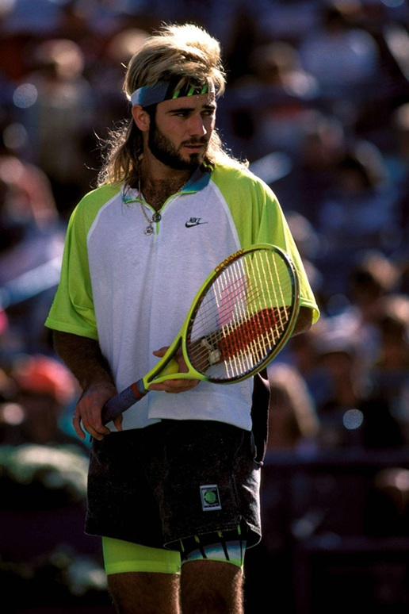
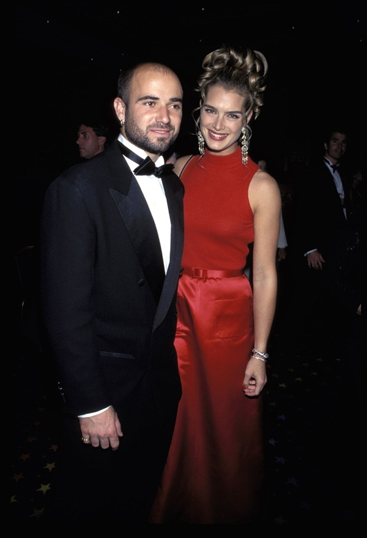
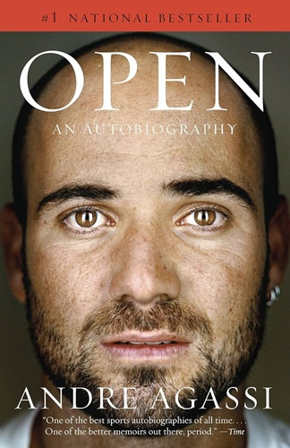
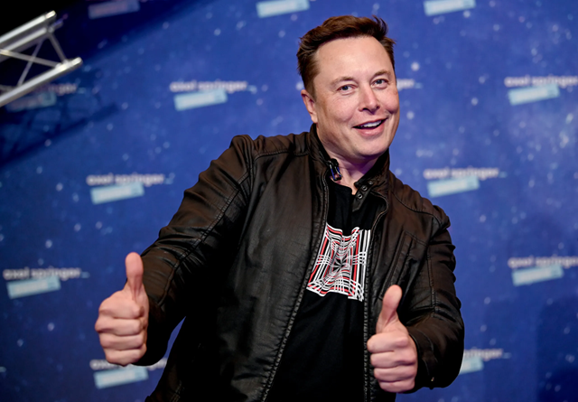
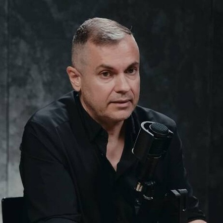
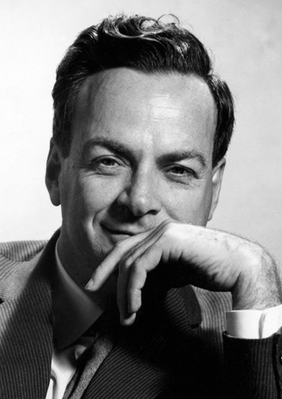
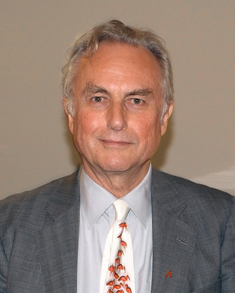

After defining [in my previous post]() the qualities someone needs to qualify as my personal role model, the time has come to pick a good one. As much as I'd like to, I can't compile an exhaustive list of candidates for each field, so I'm just writing this post as a stream of thought, considering only those individuals who readily come to mind.

It's clear my hero won't be anyone working in the arts because, let's admit it, these people are usually textbook examples of the [Dunning-Kruger effect](https://en.wikipedia.org/wiki/Dunning%E2%80%93Kruger_effect), their main problem coming not from ignorance, but from arrogance. Artists look pretty stupid when lecturing the masses on matters they don't understand. By that I mean social and economic policies whose effects they have been insulated from and which, by their very nature, are messy and have consequences that are very hard to foresee.

Leaving artists behind, I find sportspeople more honest; simply limiting their opinions to their own fields shows greater self-awareness than that of the previous group and lets you admire grit and craftiness without being bothered by dull statements. In the world of individual sports, we get remarkable examples that meet requirements 1 (skin in the game) and 3 (remarkable life) from the list in my previous post. For example, *Rafael Nadal* also has something to offer on point 2 (anti-establishment) by virtue of several statements regarding [equal pay in men's and women's tennis](https://www.youtube.com/watch?v=u5R56Dpmufk), and is off the charts when it comes to authenticity (4). Unfortunately, his iron will makes him very unrelatable (6); it's striking that I've never seen Nadal perform disappointingly. He might have lost to a better opponent or been defeated by unmanageable conditions, but he has never given up. To really understand this, I recommend watching the Netflix documentary [Rafa](https://www.netflix.com/es/title/81785900), so you can see how his strength of will and, why not, stubbornness helped him overcome extreme challenges. I wish I could, but I find it impossible to relate to someone like this. One cannot write about Rafa without automatically considering his dancing partner throughout all these years, *Roger Federer*. The problem with the Swiss player is that, unlike Rafa, he never went through the [hero's journey](https://en.wikipedia.org/wiki/Hero's_journey). Roger was touched by the gods, won the talent lottery and almost managed to become the best player ever while barely evolving; I'd say he was the same player at 20 and at 30, in stark contrast to Rafa, who started as a clay-court specialist who looked somewhat lost on fast surfaces, and went on to win several grass- and fast-court majors. He also evolved his game from a defense-first approach to a more aggressive style in order to extend his career.

Back when I was a kid, *Andre Agassi* was a very special character to me. Like Nadal, he was off the charts when it came to authenticity (3). The quintessential rebel, back when tennis was still considered a gentleman's game, he looked like a rock superstar, even wearing jeans until they were forbidden. He even refused to play at Wimbledon partly because of its traditional all-white dress code and elitist atmosphere.

Of course, such a bad boy had to marry a beauty like actress Brooke Shields.

But it wasn't just his looks that were different; his playing style was too. In the old days, the tour was clearly split between two playing styles: the baseliners, whose game was adapted to the clay-court season, and the serve-and-volley players, who thrived on all other surfaces. The winners on clay were totally different from those on fast courts and, usually, the top-ranked players were the latter, since they could earn points at more tournaments. Agassi broke this pattern; he reached the Roland Garros final in 1990, at the age of 20, and won Wimbledon in 1992. I somehow managed to get my parents to buy me his Nike Huarache sneakers and other gear, like his white cap and a wristband.

All of this explains how a young kid could be starstruck by this colorful personality, but nobody knew what was really going on behind the scenes until Andre published his autobiography.

It doesn't matter if you don't care a bit about tennis or even know who Andre is; I recommend his book. I won't spoil anything here. I'll just say Agassi was a tortured soul, had a troubled childhood, endured an abusive father, hated tennis and had many insecurities. A very tender personality lay behind all the camera flashes. I read his book many years later, when I was already an adult, found him very relatable (6) and identified with his personality. My conclusion: he is clearly a good *hero* candidate for me.

Nowadays, we no longer have adventurous explorers; the world has already been charted, all the information is on the internet and technology has made life easy. We don't have conquerors either; wars are directed from offices and fought by remote means. Only in entrepreneurship and elite sports can we see people giving their all in high-stakes situations, facing enemies, competition and even the government in pursuit of their dreams. The controversial *Elon Musk* is a clear candidate. His companies have revolutionized two different industries: automotive and space. Before [Tesla](https://en.wikipedia.org/wiki/Tesla,_Inc.), electric cars were an esoteric niche produced in low volumes; the industry had never really been able to deliver a practical electric car for the mass market. Tesla's first attempt came with the [Roadster](https://en.wikipedia.org/wiki/Tesla_Roadster_(first_generation)). Somehow, nobody in the industry had thought that laptop-style lithium-ion batteries could power a car, so Tesla combined thousands of them, taking advantage of an industry standard and higher energy density to deliver something no other company had ever produced: an electric car with a range of more than 300 km. But a sports car is still a rarity; with the [Model S](https://en.wikipedia.org/wiki/Tesla_Model_S), they proved electric cars could be practical for the general public and marketed to a mass audience. But revolutionizing a mature industry more than 120 years old was not enough, and he founded [SpaceX](https://en.wikipedia.org/wiki/SpaceX). For a quick reference, just read this [Ars Technica article](https://arstechnica.com/space/2026/10/spacex-no-longer-needs-nasa-and-thats-a-problem-for-americas-space-agency/?comments-page=1#comments). To summarize, after NASA retired the Space Shuttle in 2011, it relied on the Russian Soyuz to put humans in orbit until SpaceX delivered that capability in 2020. That in itself is an achievement, but during that time, they revolutionized uncrewed flight, almost making it a commodity. Nowadays, it's routine to see the first stage of the Falcon 9 landing vertically, but in 2010 it was doubtful whether this was even feasible. Nobody else has delivered that level of productivity to NASA.

>As of October 27, 2026, rockets from the Falcon 9 family have been launched 713 times, with 710 full mission successes, two mission failures during launch,[a] one mission failure before launch,[b] and one partial failure.[c]

Elon Musk meets my first four requirements (1, 2, 3 and 4), but fails my fifth requirement as he leads a very public life, and with that come displays of the human failings we all have. Many people find his politics appalling; I don't, but the constant criticism of his politics and how easily he fires off political arguments without much thought make him look dumb. But my main gripe is how he has under-delivered and over-promised on critical projects. I don't mind failure, but the constant lying and his inability to shut down failed projects are frustrating. The [Hyperloop](https://en.wikipedia.org/wiki/Hyperloop) / [Boring Company](https://en.wikipedia.org/wiki/The_Boring_Company) has to be one of the most public fiascos of US entrepreneurship.

Adrian Díaz Marro is a Spanish entrepreneur living in China. He speaks about the country and how it is usually misinterpreted in the Western world. He moved there in 2006 and has lived through the Wild West period that took the country, as Lee Kuan Yew would say, from third world to first. His thoughts on China, the free market, capitalism, entrepreneurship and the situation in the Western world are well developed and insightful. He's been very successful, and I really admire his bravery in adapting to such a different country and building a life for himself. However, despite all this success, he fails my sixth requirement. I find his cynicism about his home country sad. He seems resentful about the lack of opportunities in Spain that made him emigrate, as he never misses an occasion to badmouth his home country. I'm no huge nationalist either, but I find it suspicious when someone doesn't retain a little fondness for their home country and never has a good word to say about it. He also seems to enjoy how bad things are getting in Spain and Europe, as if this served to validate his choices, rather than spelling disaster for good, middle-class people.

I find more candidates in the scientific world. [Richard Feynman](https://en.wikipedia.org/wiki/Richard_Feynman) was an American theoretical physicist who has a cult following among people with my background, among others. He was a Nobel Prize winner, was part of the [Manhattan Project](https://en.wikipedia.org/wiki/Manhattan_Project) to develop the atomic bomb in WWII, was a pioneer in quantum mechanics, was part of the [Rogers Commission](https://en.wikipedia.org/wiki/Rogers_Commission_Report) that investigated the Challenger Space Shuttle disaster, and became a pop culture hero thanks to the many anecdotes in his collections [Surely You're Joking, Mr. Feynman!](https://en.wikipedia.org/wiki/Surely_You're_Joking,_Mr._Feynman!) and [What Do You Care What Other People Think?](https://en.wikipedia.org/wiki/What_Do_You_Care_What_Other_People_Think%3F), including stories about lock-picking, samba music and pranks. He died long before the internet went mainstream, so he meets requirement 5, unlike Elon Musk. However, he wouldn't pass my personal relatability check, as he was too brilliant and his reputation is so universally positive.

[Richard Dawkins](https://en.wikipedia.org/wiki/Richard_Dawkins) had a huge impact on me with his book [The Selfish Gene](https://en.wikipedia.org/wiki/The_Selfish_Gene), because its ideas made me a fan of evolutionary theory, a topic I've been reading a lot about over the last few years. However, even though I'm an atheist myself, I find his hatred of religion very off-putting. I find that, as a society, we need to be more tolerant even of unreasonable stances, as long as they don't cause social harm. If we are to change people's opinions, arrogance and steamrolling are tools that don't work.

Here are quotes from better thinkers who express what I'm trying to say much better:

> John Gray Gray has also criticised Dawkins's perceived allegiance to Darwin, stating that if "science, for Darwin, was a method of inquiry that enabled him to edge tentatively and humbly toward the truth, for Dawkins, science is an unquestioned view of the world"

> Rees and Higgs, in particular, have both rejected Dawkins's confrontational stance toward religion as narrow and "embarrassing", with Higgs equating Dawkins with the religious fundamentalists he criticises

For all his vitriol towards religion, at least I can give Dawkins props for how he goes after all religions, unlike left-wing activists who are always willing to give Islam a pass.

>In 2013 Dawkins tweeted that "All the world's Muslims have fewer Nobel Prizes than Trinity College, Cambridge. They did great things in the Middle Ages, though.

[Stephen Jay Gould](https://en.wikipedia.org/wiki/Stephen_Jay_Gould) was an American paleontologist I happened to discover through a recommendation for his book [The Panda's Thumb](https://www.goodreads.com/book/show/33933.The_Panda_s_Thumb?ref=nav_sb_ss_1_16). I find my inability to put thoughts into words frustrating, so I'll quote [this user](https://www.goodreads.com/user/show/14046996-roy-lotz) from Goodreads:

> Stephen Jay Gould is a pleasure to read. No writer I know can so seamlessly combine the cultural sophistication of belles-lettres with the rigors of scientific explanation. Gould is singularly able to frame scientific controversies and hypotheses within a larger historical context, showing the human side of the scientific endeavor while in no way minimizing its brilliance and legitimacy. Science emerges as both deeply human—colored by a thousand irrational biases and prejudices—and yet remarkably effective at getting beyond these human failings.

> I would even go so far to say that Gould is worth reading simply for the writing alone. His prose is excellent—full of personality, and yet never self-indulgent. If you are looking to write non-fiction, you could scarcely find a better model of clarity, wit, and intellectual seriousness.

To wrap up these two posts, if I had to pick my heroes, they would be Andre Agassi and Stephen Jay Gould.

