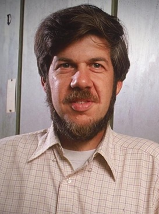

After defining [in my previous post]() the qualities someone needs to qualify as my personal role model, the time has come to pick a good one. As much as I'd like to, I can't compile an exhaustive list of candidates for each field, so I'm just writing this post as a stream of thought, considering only those individuals who readily come to mind.

It's clear my hero won't be anyone working in the arts because, let's admit it, these people are usually textbook examples of the [Dunning-Kruger effect](https://en.wikipedia.org/wiki/Dunning%E2%80%93Kruger_effect), their main problem coming not from ignorance, but from arrogance. Artists look pretty stupid when lecturing the masses on matters they don't understand. By that I mean social and economic policies whose effects they have been insulated from and which, by their very nature, are messy and have hard to foresee consequences.

So if I leave artists aside, let me think about sportspeople, who I find more honest. By simply limiting their opinions to their own fields they show better self-awareness than artists and let you admire their craftiness and grit without all the dull statements. In the world of individual sports, we get remarkable examples meeting my requirements 1 (skin in the game) and 3 (remarkable life) from the list of my previous post. For example, *Rafael Nadal* despite being disciplined and well-mannered, has also something to offer on point 2 (anti-establishment) by virtue of statements regarding [equal pay in men's and women's tennis](https://www.youtube.com/watch?v=u5R56Dpmufk). Like him or not, but he is off the charts when it comes to authenticity (4). But his discipline and iron will makes him very unrelatable (6) to my, say, more inconsistent life experience. It's striking to realize that I've never seen Nadal perform disappointingly, he either lost to a better opponent or was defeated by his own body, but he never gave up. He was admitedly rattled in his first French Open defeat to Robin Soderling in 2009, but made up for this the next year. To really understand his personality, I recommend watching the Netflix documentary [Rafa](https://www.netflix.com/es/title/81785900), to see how his willpower and, why not, stubbornness helped him overcome extreme challenges.



You can't write about Rafa without automatically considering his dancing partner all these years *Roger Federer*. The Swiss was the polar opossite to Nadal, gliding effortlessly on the court, shortening points, attacking on the serve and, generally, playing a more elegant ball than Nadal. However, Roger, unlike Rafa, never made the [hero's journey](https://en.wikipedia.org/wiki/Hero's_journey). He was touched by the gods, won the talent lottery and almost managed to become the best player ever without barely evolving. That, too, makes him a bit unrelatable to a person like me whose abilities are mostly located in the center part of the bell curve. I'd even say Roger was the same player by 20 and 30 years old, in stark contrast to Rafa, who began as a clay-court specialist who looked somewhat lost on fast surfaces, and went on to win several grass and fast-court majors. Nadal would have already been a historic player had he retired by 2017 after the breakup with his long time coach Toni Nadal, but managed to evolve his game under coach Carlos Moyá, somehow diminishing the qualities than made him elite to modify his playstyle to extend his career. He went from a defense-first approach to a more aggressive striking to shorten points. Altough I acknowledge some unfairness in Roger's career judgement, he could never make such adjustment. Honestly, very few athletes have ever; Michael Jordan comes to mind.



But let me move on to my next candidate. Back when I was a kid, another tennis player *Andre Agassi* was making the headlines and I was paying attention. Like Nadal, but for very different reaons as I'd learn later, he was off the charts when it came to authenticity (3). The quintessential rebel, back when tennis was a more traditional sport, he looked like a rock superstar, playing wearing jeans, long blonde hair and colorful outfit. He even refused to play at Wimbledon partly because of its traditional all-white dress code and elitist atmosphere.



Of course, a bad boy had to marry gorgeous actress Brooke Shields.



But it wasn't just his looks that were different; his playing style was too. In the old days, the tour was clearly split between two playing styles: the baseliners, whose game was adapted to the clay-court season, and the serve-and-volley players, whose style was better adapted to all other surfaces. The players winning on clay were totally different from those on fast courts and, usually, the top-ranked players were the latter as more tournaments are played in fast surfaces. Andre broke this pattern; he reached the Roland Garros final in 1990, aged 20, and won Wimbledon two years later in 1992. I was starstruck and somehow managed to get my parents to buy me his Nike Huarache sneakers and other gear, like his white cap and a wristband.



All of this explains why a young kid like me became a huge fan, but nobody knew what was really going on his head, until Andre published his autobiography.



This is what makes Andre Agassi a very special personality to me. I noticed him when I was a child and got hooked on his external appearances and success, but as an adult I learnt his personality was not as it looked, but much more similar to someone like me, so he no doubt checks my sixth requirement. It doesn't matter if you don't care about tennis or even know who Andre is; I recommend his book. I'll try not to spoil too much here, I'll just say Agassi was a tortured soul, had a troubled childhood, endured an abusive father, and had many insecurities. A very tender personality layed behind all the camera flashes. He makes a good *hero* candidate for me.

Nowadays, we no longer have adventurous explorers; all the world has been charted, much information is available on the internet and, in general, technology has made life easy for a potential explorer. We don't have conquerors either; wars are directed from headquarters in air-conditioned offices, fought by remote means like UAVs and their consequences are bear only by the people, not the instigators who, in the past, usually end up killed. Only in entrepreneurship and elite sports we see performers giving their all in high-stakes situations, facing enemies, competition and the final boss (the government) in pursuit of their dreams. The most remarkable entrepreneur of this era, the always controversial *Elon Musk* is a candidate to evaluate. His companies have revolutionized two different industries, automotive and space, and this alone puts him in a different conversation than almost any other. Before [Tesla](https://en.wikipedia.org/wiki/Tesla,_Inc.), electric cars were an esoteric niche produced in low volumes; the industry had never really been able to deliver a practical electric car for the mass market. Tesla's first attempt came with the [Roadster](https://en.wikipedia.org/wiki/Tesla_Roadster_(first_generation)). Somehow, nobody in the industry had thought that laptop-style lithium-ion batteries could power a car. Tesla combined thousands of them, taking advantage of an industry standard and higher energy density to deliver something no other company had ever produced: an electric car with a range of more than 300 km. In any case, a sports car is still 'a rarity'; their next effort the [Model S](https://en.wikipedia.org/wiki/Tesla_Model_S), proved that electric cars could be practical for the general public and could marketed to a mass audience. But revolutionizing a mature industry with more than 120 years of history was not enough, so he founded [SpaceX](https://en.wikipedia.org/wiki/SpaceX). A quick overlook can be found in this [Ars Technica article](https://arstechnica.com/space/2026/10/spacex-no-longer-needs-nasa-and-thats-a-problem-for-americas-space-agency/?comments-page=1#comments). To summarize, after NASA retired the Space Shuttle in 2011, they ended up relying on the old but proven Russian Soyuz to put humans in orbit until SpaceX delivered again that capability in 2020. That in itself is an achievement, but is nothing compared to what they did during that time, nothing short of revolutionizing uncrewed flight, almost making it a commodity. Among those efforts to make space cargo transportation cheaper was rocket reuse. Nowadays, it's routine to see the first stage of the Falcon 9 landing vertically, but in 2010 it was doubtful whether this was even feasible. The productivity they have delivered to NASA cannot be compared to any other supplier be it Boeing, ULA or Blue Origin:

>As of October 27, 2026, rockets from the Falcon 9 family have been launched 713 times, with 710 full mission successes, two mission failures during launch, one mission failure before launch, and one partial failure.

Elon meets my first four requirements but fails the fifth because he lives a very public life, and leading to unavoidable displays of human failings. The main problem for many people is his politics, but I mostly agree with his arguments. Nevertheless, he usually fires off opinions without much thought, obviously not caring about what other people think, which makes him look like a dumb troll. That would be fine, I guess, but my main gripe is how he has over-promised and under-delivered on critical projects that ended up looking like scams. I don't mind failure, but the constant lying and his inability to abandon failed ideas are frustrating. For example, the [Hyperloop](https://en.wikipedia.org/wiki/Hyperloop) / [Boring Company](https://en.wikipedia.org/wiki/The_Boring_Company) has been an embarrassment since day one. Also, his companies operate on the edge of what's fair or legal, and one could say that some activities, like being a member of the government while also supplying critical services (in space, for example), is a conflict of interests.



Adrian Díaz Marro is a Spanish entrepreneur living in China. His main activity is to partner with companies to help them enter the market or build factories to supply some other countries. Furthermore he uses social media to popularize the country economic and social outlook, and explains how China is usually misinterpreted in the Western world. He moved there in 2006 and has lived the Wild Wild West period that took the country, as Lee Kuan Yew would say, from third world to first. His thoughts on China, free market, capitalism, entrepreneurship and the situation in the Western world are unique, well developed and insightful, he might be the best China divulgator out there, in all languages. Adrian has been very successful; I really admire his bravery to move and adapt to a very different country and building a future for himself coming from a middle class background. But despite all this praise, he's very unrelatable. Adrian cynicism about his home country is sad. I do share most of his arguments about how Spain, and Europe in general, are economic and socially decadent, but what makes me sad, he seems to very much enjoy. It's like he was still resentful about the lack of opportunities that made him emigrate, after all his life success, still he can't forgive and retain a little fondness for his home country.



I'm thinking about more candidates in the sciences. [Richard Feynman](https://en.wikipedia.org/wiki/Richard_Feynman) was an American theoretical physicist who has a cult following from, among many others, people with my computer science background. He was a Nobel Prize winner, was part of the [Manhattan Project](https://en.wikipedia.org/wiki/Manhattan_Project) to develop the atomic bomb in WWII, was a pioneer in quantum mechanics, was part of the [Rogers Commission](https://en.wikipedia.org/wiki/Rogers_Commission_Report) that investigated the Challenger Space Shuttle disaster and became a pop culture hero thanks to the many anecdotes told in his collections [Surely You're Joking, Mr. Feynman!](https://en.wikipedia.org/wiki/Surely_You're_Joking,_Mr._Feynman!) and [What Do You Care What Other People Think?](https://en.wikipedia.org/wiki/What_Do_You_Care_What_Other_People_Think%3F), including stories about lock-picking, samba music, travels, education, strategy and, surprisingly, being a prankster. He died long before the internet went mainstream so, unlike Elon Musk, he meets requirement 5. However, my personal relatability check he won't pass because his brilliance, self-assuredness, originallity and universally good reputation puts him too far away from me to be someone to aspire to imitate.



[Richard Dawkins](https://en.wikipedia.org/wiki/Richard_Dawkins) had a huge impact on me with his book [The Selfish Gene](https://en.wikipedia.org/wiki/The_Selfish_Gene), as this read made me a fan of evolutionary theory, a topic I've adopted as hobby and have been reading a lot about over the last few years. Dawikins is not only an atheist, but a fierce critic of religion. I'm an atheist myself, but Dawkins hatred towards religion is very off-putting. Two criticism I would make to Dawkins on this. First, even if his argument is right and religion is indeed so hurtful to a society, his stance would never work to convert to his cause. It has been proven that arrogance and agressively antagonizing the opposite group are tools that don't work to change minds. Second, by being so arrogant, he forgets social science is not his field, and is oblivious to many good arguments about how religions might be good for society and how some religions are better than others. See [this](https://www.goodreads.com/book/show/51710349-the-weirdest-people-in-the-world) or [this](https://www.youtube.com/watch?v=GVVMRtIkXJg) sources.

I've done my best, with my criticism, but I can also quotes better thinkers who much better express what I'm trying to say:

> John Gray Gray has also criticised Dawkins's perceived allegiance to Darwin, stating that if "science, for Darwin, was a method of inquiry that enabled him to edge tentatively and humbly toward the truth, for Dawkins, science is an unquestioned view of the world"

> Rees and Higgs, in particular, have both rejected Dawkins's confrontational stance toward religion as narrow and "embarrassing", with Higgs equating Dawkins with the religious fundamentalists he criticises

However, I need to give Dawkins respect regarding his consistency on how he goes after all religions, unlike the strange marriage of left-wing activists and Islam

>In 2013 Dawkins tweeted that "All the world's Muslims have fewer Nobel Prizes than Trinity College, Cambridge. They did great things in the Middle Ages, though.



And to finish this post, my last candidate, [Stephen Jay Gould](https://en.wikipedia.org/wiki/Stephen_Jay_Gould), an American paleontologist I happened to discover through a recommendation for his book [The Panda's Thumb](https://www.goodreads.com/book/show/33933.The_Panda_s_Thumb?ref=nav_sb_ss_1_16). He won many accolades in his professional life but never reached Nobel prize heights. His writing style is what caught my eye; reading his essays made me feel I'd like this guy to be my friend. He had an uncanny ability to merge laypeople experiences with the main scientific topic of a given essay. He showed how the scientific pursuit is very human, like no other author. His writings about daily life experiences, about american culture, sports, social stances and many others are full of originality, humility and cleverness.

Same I did with Dawkins, I find better statements have been written out there to illustrate my thoughts. I'll quote [this user](https://www.goodreads.com/user/show/14046996-roy-lotz) from Goodreads:

> Stephen Jay Gould is a pleasure to read. No writer I know can so seamlessly combine the cultural sophistication of belles-lettres with the rigors of scientific explanation. Gould is singularly able to frame scientific controversies and hypotheses within a larger historical context, showing the human side of the scientific endeavor while in no way minimizing its brilliance and legitimacy. Science emerges as both deeply human—colored by a thousand irrational biases and prejudices—and yet remarkably effective at getting beyond these human failings.

> I would even go so far to say that Gould is worth reading simply for the writing alone. His prose is excellent—full of personality, and yet never self-indulgent. If you are looking to write non-fiction, you could scarcely find a better model of clarity, wit, and intellectual seriousness.

I think this writing has been useful for myself to clarify my own values. I need to leave this entry here happy to have found that, at least I have found two suitable heroes for myself in the personalities of Andre Agassi and Stephen Jay Gould. I'd like better to have found an Spanish candidate, but who knows, I'll keep my eyes open and maybe someday the right countrymen will appear to enlight me in my life travel.

