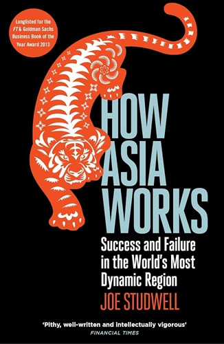
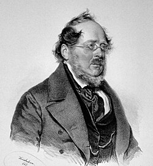

I've always read, had busy and low seasons, but it's a good habit I've never let go. Nowadays, I find other hobbies disappointing. For example, every year the movie industry gets worse as both *woke* and *profit* are to blame, but I'd be lying if I don't assign a good chunk of culpability to my own industry with its constant monitoring practices, that give an excuse to the executives to pull the plug, as soon as the numbers dissapoint, without letting any show mature.

But back to reading. Nowadays we have many legal platforms where we can reach any published book by clicking once. For past-times like videogames or movies, that availability backfires because their very nature provokes an inability make a decision between plentiful options. In contrast, I've always been able to easily choose a book that I end up finishing and rarely drop one before the end. My reading hobby feels grounding because its long format is not conductive to the small dopamine hits that gets you addicted but, at the same time, dissoriented and unable to focus, typical from social networks.

While I enjoy a good novel, I'm more on divulgative essays on topics that explain why human societies have reached its current form; themes like history, evolutionary psychology, religion, capitalism, war, biology, evolution or paleontology. I'm past a point of expecting easy cause-and-effect reasons on messy human topics, but many authors have come up with reasonings that apply to some groups, in some spot of human history, that might not provide complete certainties but at least plausibliy give reasons on why our civilizations took its current shape.

Some of this authors have reached fame and best-seller status

while other have become solid sellers

but the work that has motivated me to write this entry is one I feel a bit unappreciated: [How Asia Works](https://www.goodreads.com/book/show/245526265) by Joe Studwell. Its Amazon entries [here](https://www.amazon.com/How-Asia-Works-Joe-Studwell/dp/0802121322?crid=1WV9TTN5QPE52&dib=eyJ2IjoiMSJ9.fj1M_3hjlYWAUrqTyWYOOpU0nzEkI9_sV9DdwMolFBCnC5zbLRCB9hlA1ljuQkwpjYXwFL8LKxcYur8Xkv0WDU-KU2yEUr3G5qIHOJ0CPctGNFYnfdl2Cfm_1xNRXSQe1UQKWKQAX5NfsASowdQg_FdZ1MnBGt5W5KTSkqgWKdC8j2slbIu_LdNdSH2RRbtC1AsaoOFbfz91Vz_Ngr_R70rG5T6UDPcboQlvckzC_us.zqks3i7MMhiOxtfBTY3EUgKdlHqXFaGOgCoFZROgPOU&dib_tag=se&keywords=how%2Basia%2Bworks&qid=1794429322&sprefix=how%2Basia%2Bwor%2Caps%2C262&sr=8-1&th=1) and [here](https://www.amazon.com/How-Asia-Works-Studwell-published/dp/B0164K3X8U?crid=1WV9TTN5QPE52&dib=eyJ2IjoiMSJ9.fj1M_3hjlYWAUrqTyWYOOpU0nzEkI9_sV9DdwMolFBCnC5zbLRCB9hlA1ljuQkwpjYXwFL8LKxcYur8Xkv0WDU-KU2yEUr3G5qIHOJ0CPctGNFYnfdl2Cfm_1xNRXSQe1UQKWKQAX5NfsASowdQg_FdZ1MnBGt5W5KTSkqgWKdC8j2slbIu_LdNdSH2RRbtC1AsaoOFbfz91Vz_Ngr_R70rG5T6UDPcboQlvckzC_us.zqks3i7MMhiOxtfBTY3EUgKdlHqXFaGOgCoFZROgPOU&dib_tag=se&keywords=how+asia+works&qid=1794429322&sprefix=how+asia+wor%2Caps%2C262&sr=8-10) show about 1000 ratings and the book has not even been translated to Spanish.

One of the main reasons I like this book is because the advice it provides is concrete, not the typical word sallad meant to sound good, of many popular economic books. Here you have clear ideas of measures that work, and examples of their (or lack of) implementation.

Studwell first covers the macroeconomic policies he thinks a country should take to get from poor to developed. He states a nation needs first an agricultural policy, second an industrial policy and, third and last, financial reform, **in that order**. He makes remarkable points like, on industrial policy, how something like protectionism can be beneficial if, and only if, is meant for infant industries and **losers are pruned by export discipline**. On financial reform, he states that many of the usual directives from institutions like the IMF or World's Bank are counter-productive because they usually focus on finance, before the other pieces are set. 

If this book is kind of obscure, so is the german ecomomist [Friedrich List](https://en.wikipedia.org/wiki/Friedrich_List) whose teachings Studwell shows are very much applicable to developing countries. By reading this text I got to know his name, let alone his ideas. His popularity pales in comparison to others like Adan Smith, John Maynard Keynes, and many other, who knows why, but maybe because his advice... actually works.

Then, he covers the recent history of several countries like Japan or the Asian tigers (Taiwan, South Korea, Singapore and Hong Kong) and how they became sucessfull by following this playbook, and how some others less succesfull countries from East Asia fumbled the ball by not following one or more of the steps of the recipe. The case of China is very remarkable, as this book was published in 2013. By then, despite China following all steps, Studwell was considering whether an authoritarian regime could be dynamic enough to produce national champions capable of competing worldwide. By now, the answer is clear and we have learnt that the policies proved to be more important than the political regime.

Although this title provides contrasted advice, each country's tale shows how much luck still plays a part. For example, rulers actions are limited by their ability to stay in power and many of the measures discussed are long-term, unpopular and go against the interests of the country's elite and even against those of more powerful nations. These are usually a bad spell for a head of state that wants to keep ruling. However, in the cases of South Korea and Taiwan, an autocrat ruler with unchallenged power was a blessing in disguise, as he had the time and strength to walk all the way. This video from [CGP Grey on Power](https://www.youtube.com/watch?v=rStL7niR7gs) or [Niccolo Maquiavelli works](https://www.amazon.es/Prince-Penguin-Classics-Niccolo-Machiavelli/dp/0140449159?th=1) shows the limitations of power.